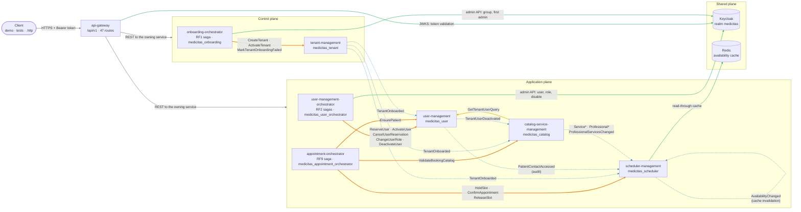
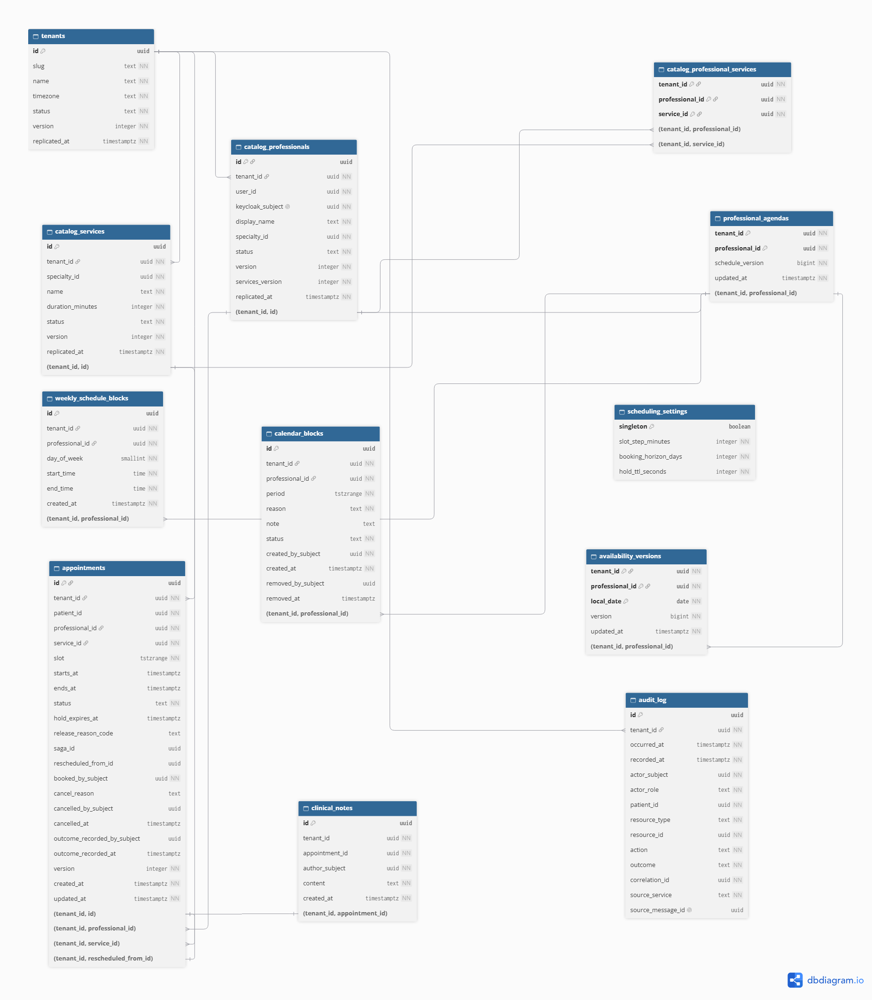
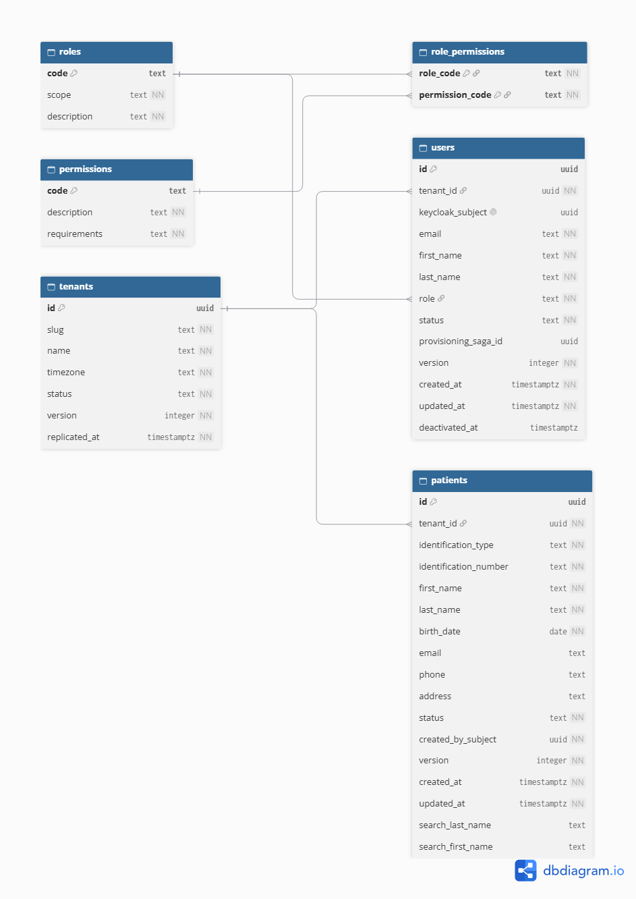
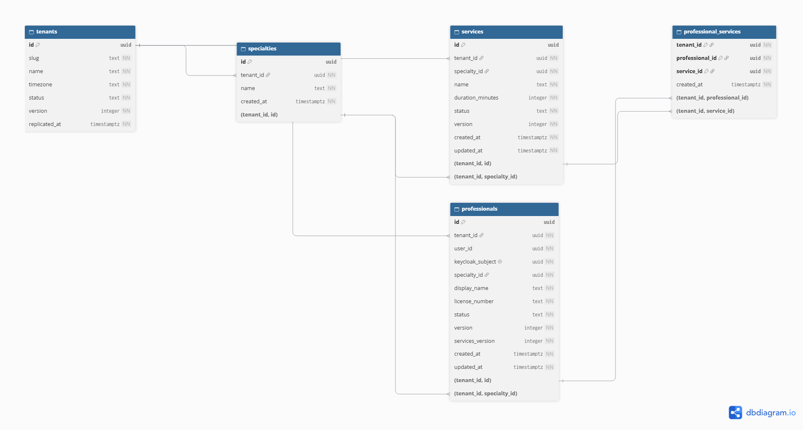
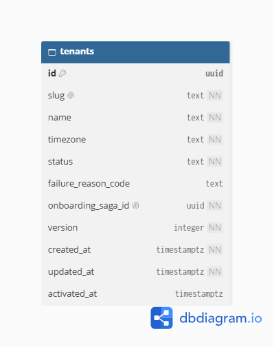
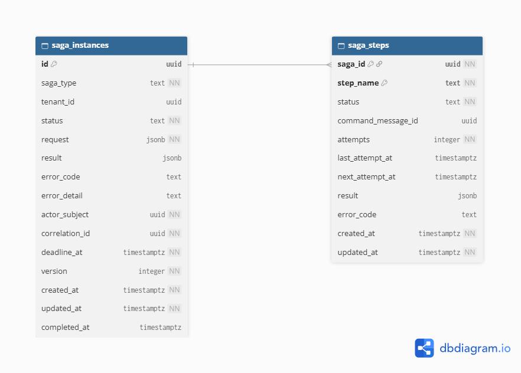
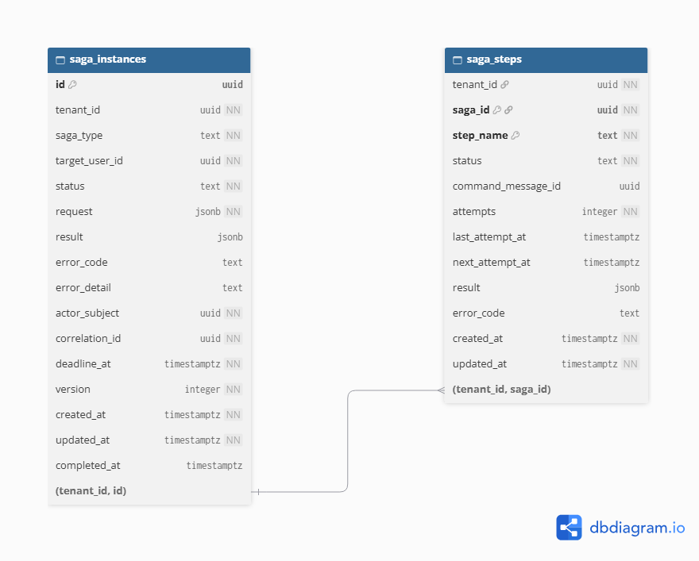
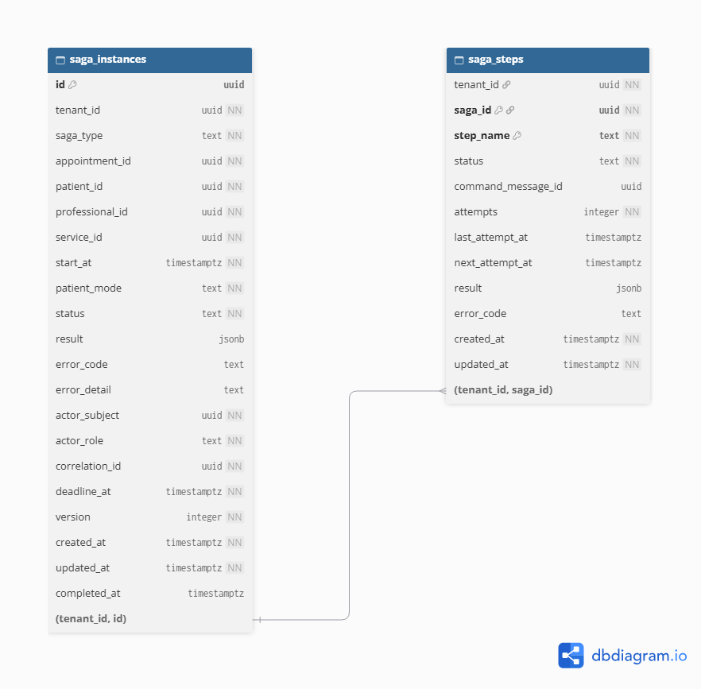
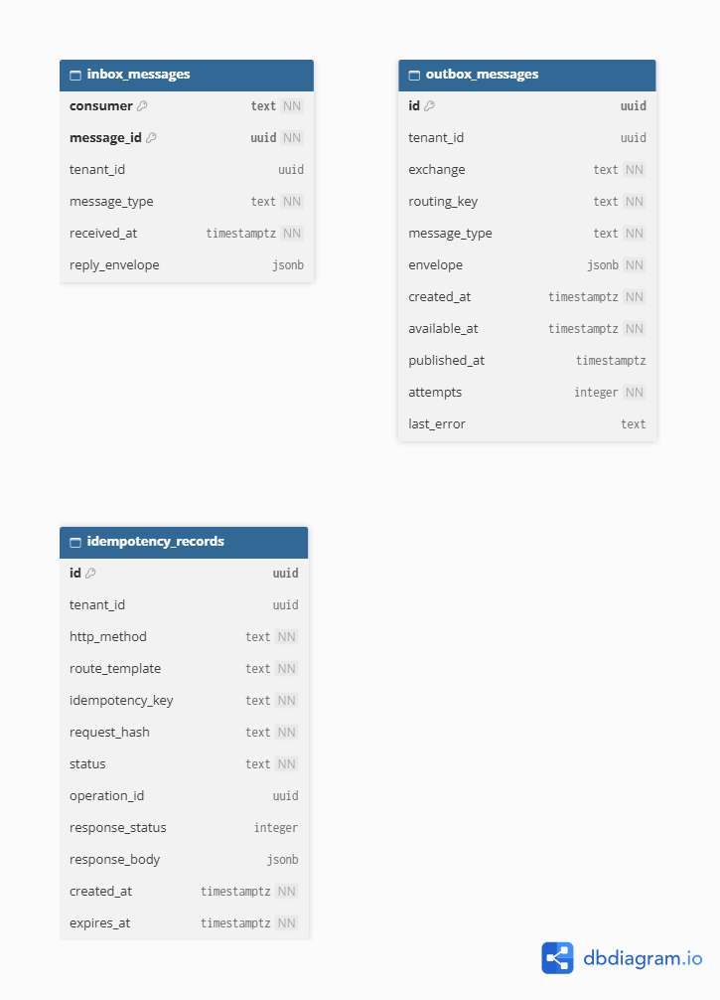

# MediCitas

Multi-tenant SaaS platform for medical appointments: backend and data platform (no frontend).
Course project: Arquitectura e Ingeniería de Datos, OLTP core. 
Group module selected: **Row-Level Security as a second multi-tenancy strategy** (module 2).

This README holds the deliverables the course statement asks for: reproducible instructions, the route contract, the design with the entity-relationship diagram, the multi-tenancy comparison, the isolation decision with its trade-offs, and the test report. The declaration of AI use is in [`docs/ai-usage-declaration.md`](docs/ai-usage-declaration.md).

---

## 1. Reproducible instructions

### Requirements

| Tool | Check | Expected |
|---|---|---|
| Docker Desktop / Engine with Compose v2 (approx. 4 GB of RAM for the stack) | `docker compose version` | v2.x or higher |
| Node.js 24 | `node -v` | v24.x |

For the project to function correctly, its necessary to have the next host ports free (bound to 127.0.0.1 only): 8000, 8080, 5432, 5672, 15672, 6379 - its possible to configure them in `.env`.

On Windows PowerShell, if `npm` reports that running scripts is disabled, call `npm.cmd` / `npx.cmd`.

### Start the system (one command)

```bash
npm ci  #Its not needed to run the system, only to run tests and metrics evaluations.
cp .env.example .env    #Configure the passwords and ports if needed
docker compose up --build          # or: docker compose up -d --build --wait  (returns when everything is healthy)
```

| Component | Result | Host access |
|---|---|---|
| API gateway | The only public entry point: validates the Keycloak token, enforces the permission matrix, forwards | `http://localhost:8000/api/v1` |
| 7 domain services | tenant-management, onboarding-orchestrator, user-management, user-management-orchestrator, catalog-service-management, scheduler-management, appointment-orchestrator | internal only |
| PostgreSQL 18 | 7 databases (one per service), least-privilege roles, RLS, migrations and a seed of 3 clinics | `5432` |
| RabbitMQ 4.3 | Exchanges, quorum queues, retry tiers, DLQs, one broker user per service | `5672`, UI `15672` |
| Redis 8.8 | Availability cache only | `6379` |
| Keycloak 26.7.4 | Realm `medicitas` with roles, clients, `tenant_id` claim mapper and seeded users | `http://localhost:8080` |

Migrations, seeds, the broker topology and the Keycloak realm are applied automatically by one-shot containers, nothing is configured by hand.

Automated demostrations of the whole appointment cycle (RF7–RF13) and of the read-only route contract. They can be run with:
```bash
npm run smoke          # 10 read-only checks through the gateway
npm run demo -- --pause   # step-by-step walkthrough of the whole appointment cycle
```

Seeded logins. Passwords are never in the repository; they are read from the local `.env`.

| Tenant | User | Role | Password variable |
|---|---|---|---|
| Clínica San José (clinic 1) | `ana.mora@sanjose.medicitas.test` | Clinic administrator | `MEDICITAS_DEMO_USER_PASSWORD` |
| Clínica San José (clinic 1) | `carlos.jimenez@sanjose.medicitas.test` | Receptionist | `MEDICITAS_DEMO_USER_PASSWORD` |
| Clínica San José (clinic 1) | `laura.vargas@sanjose.medicitas.test` | Receptionist | `MEDICITAS_DEMO_USER_PASSWORD` |
| Clínica San José (clinic 1) | `andres.rojas@sanjose.medicitas.test` | Health professional | `MEDICITAS_DEMO_USER_PASSWORD` |
| Centro Médico Heredia (clinic 2) | `diego.araya@heredia.medicitas.test` | Receptionist | `MEDICITAS_DEMO_USER_PASSWORD` |
| Platform (no tenant) | `platform.admin@medicitas.test` | Platform administrator | `MEDICITAS_PLATFORM_ADMIN_PASSWORD` |

Manual call (tokens are issued by Keycloak, never by MediCitas):

```bash
set -a; . ./.env; set +a
TOKEN=$(curl -s -d grant_type=password -d client_id=medicitas-cli -d username=carlos.jimenez@sanjose.medicitas.test \
  --data-urlencode "password=$MEDICITAS_DEMO_USER_PASSWORD" \
  http://localhost:8080/realms/medicitas/protocol/openid-connect/token | node -pe 'JSON.parse(require("fs").readFileSync(0)).access_token')
curl -s -H "Authorization: Bearer $TOKEN" http://localhost:8000/api/v1/me
```

### Run the tests (one command, with the stack up)

```bash
npm test                  # unit, then integration against the running stack (≈ 2 minutes)
npm run test:unit         # 93 unit tests, no Docker needed (≈ 3 s)
npm run test:integration  # 98 integration tests against the Compose stack (≈ 2 minutes)
npm run typecheck && npm run check:no-any
```

The tests create their own data (a fresh clinic per run, onboarded through the API) and need no manual preparation. Vite/Vitest cannot run from a directory whose path contains `#`; in that case run them through a junction, see [`tests/README.md`](tests/README.md).

Reset to the pristine seed: `docker compose down -v && docker compose up -d --build --wait`.

---

## 2. Route contract

### Conventions (every route)

* **JSON only** (`415` otherwise, body ≤ 64 KB → `413`); unknown body or query properties → `400 VALIDATION_FAILED` (this also blocks any injected `tenantId`).
* **Authentication:** `Authorization: Bearer <Keycloak access token>` on every `/api` route. Missing token → `401 AUTHENTICATION_REQUIRED`; invalid signature, issuer, audience or expiry → `401 TOKEN_INVALID`; valid token without the permission → `403 FORBIDDEN`. The clinic is **always** taken from the token.
* **Not found:** an id that does not exist in the caller's clinic (including ids of other clinics) → `404 RESOURCE_NOT_FOUND`; existence in another clinic is never revealed. Unknown route → `404 ROUTE_NOT_FOUND`; known path with another method → `405` with `Allow`.
* **Errors** are RFC 9457 `application/problem+json` with a stable `code` and the `correlationId`; `X-Correlation-Id` is echoed on every response.
* **Idempotency:** `Idempotency-Key` (16–64 chars) — the same key and body replays the original answer (`Idempotent-Replayed: true`); the same key with another body → `422 IDEMPOTENCY_KEY_REUSED`; missing where required → `400 IDEMPOTENCY_KEY_REQUIRED`.
* **Lists:** `{ data: [...], page: { limit, nextCursor } }`, keyset pagination with `limit` (1–100) and an opaque `cursor`.
* **Long-running operations** (sagas): `201`/`200` when finished within 8 s, otherwise `202 Accepted` with `Location` of an operation resource `{ operationId, status: running|completed|failed, result, error }`. A `202` is not a failure.
* **Dependencies down:** `503 DEPENDENCY_UNAVAILABLE` with `Retry-After`.

### Routes

Common errors above apply to every route; the table lists the route-specific ones. *IK* = `Idempotency-Key` required.

| # | Method & path | Permission | Input | Success | Specific errors |
|---|---|---|---|---|---|
| 1 | `GET /me` | any authenticated | — | `200 { subject, tenantId, roles, permissions }` | — |
| 2 | `POST /tenants` *(IK)* | `tenants:onboard` | `{ name, slug, timezone, firstAdmin: { email, firstName, lastName, temporaryPassword } }` | `201 { tenantId, slug, name, timezone, status, operationId, firstAdmin }` or `202` | `409 TENANT_SLUG_TAKEN, EMAIL_TAKEN`; `422 INVALID_TIMEZONE` |
| 3 | `GET /tenant-onboardings/{operationId}` | `tenants:read` | — | `200` operation | — |
| 4 | `GET /tenants?status&limit&cursor` | `tenants:read` | — | `200` list of tenants | — |
| 5 | `GET /tenants/{tenantId}` | `tenants:read` | — | `200 { tenantId, name, slug, timezone, status, createdAt }` | — |
| 6 | `POST /users` *(IK)* | `users:manage` | `{ email, firstName, lastName, role, temporaryPassword }` | `201 User` + `Location`, or `202` | `400` (role `platform_admin`); `409 EMAIL_TAKEN` |
| 7 | `PATCH /users/{userId}/role` | `users:manage` | `{ role }` | `200 User` or `202` | `409 LAST_CLINIC_ADMIN, INVALID_STATE_TRANSITION` |
| 8 | `POST /users/{userId}/deactivate` | `users:manage` | — | `200 User` (`inactive`) or `202` | `409 LAST_CLINIC_ADMIN, INVALID_STATE_TRANSITION` |
| 9 | `GET /user-operations/{operationId}` | `users:manage` | — | `200` operation | — |
| 10 | `GET /users?role&status&q&limit&cursor` | `users:manage` | — | `200` list of users | — |
| 11 | `GET /users/{userId}` | `users:manage` | — | `200 { userId, keycloakSubject, email, firstName, lastName, role, status }` | — |
| 12 | `POST /specialties` | `catalog:manage` | `{ name }` | `201 { specialtyId, name }` | `409 SPECIALTY_NAME_TAKEN` |
| 13 | `GET /specialties?limit&cursor` | `catalog:read` | — | `200` list | — |
| 14 | `POST /services` | `catalog:manage` | `{ name, specialtyId, durationMinutes }` (5–480, multiple of 5) | `201 { serviceId, name, specialtyId, durationMinutes, status, version }` | `409 SERVICE_NAME_TAKEN` |
| 15 | `GET /services?status&specialtyId&limit&cursor` | `catalog:read` | — | `200` list | — |
| 16 | `GET /services/{serviceId}` | `catalog:read` | — | `200` service | — |
| 17 | `PATCH /services/{serviceId}` | `catalog:manage` | any of `{ name, durationMinutes, status }` | `200` service (future bookings use the new duration) | `409 SERVICE_NAME_TAKEN` |
| 18 | `POST /professionals` | `catalog:manage` | `{ userId, specialtyId, displayName, licenseNumber }` | `201 { professionalId, userId, keycloakSubject, displayName, licenseNumber, specialtyId, status }` | `409 PROFESSIONAL_ALREADY_REGISTERED`; `422 USER_NOT_ELIGIBLE` |
| 19 | `GET /professionals?status&specialtyId&serviceId&limit&cursor` | `catalog:read` | — | `200` list | — |
| 20 | `GET /professionals/{professionalId}` | `catalog:read` | — | `200` professional | — |
| 21 | `PATCH /professionals/{professionalId}` | `catalog:manage` | any of `{ displayName, licenseNumber, specialtyId, status }` | `200` professional | `409 SPECIALTY_CHANGE_CONFLICT` |
| 22 | `PUT /professionals/{professionalId}/services` | `catalog:manage` | `{ serviceIds: [...] }` (replaces the set) | `200 { professionalId, serviceIds, version }` | `422 SPECIALTY_MISMATCH, SERVICE_INACTIVE` |
| 23 | `GET /professionals/{professionalId}/services` | `catalog:read` | — | `200` services offered | — |
| 24 | `PUT /professionals/{professionalId}/weekly-schedule` | `schedule:manage` or `schedule:manage-own` | `{ blocks: [{ dayOfWeek 1–7, startTime, endTime }] }` (several per day) | `200 { professionalId, timezone, scheduleVersion, blocks, conflicts }` | `403` (not own); `409 SCHEDULE_OVERLAP`; `422 PROFESSIONAL_INACTIVE` |
| 25 | `GET /professionals/{professionalId}/weekly-schedule` | `schedule:read` | — | `200 { professionalId, timezone, scheduleVersion, blocks }` | — |
| 26 | `POST /professionals/{professionalId}/calendar-blocks` | `schedule:manage` or `schedule:manage-own` | `{ startAt, endAt, reason: vacation\|leave\|other, note? }` | `201 { blockId, …, conflicts }` (booked appointments are listed, not cancelled) | `403`; `422 PROFESSIONAL_INACTIVE, DATE_RANGE_TOO_LARGE` |
| 27 | `GET /professionals/{professionalId}/calendar-blocks?from&to` | `schedule:read` | — | `200` list of blocks | — |
| 28 | `DELETE /professionals/{professionalId}/calendar-blocks/{blockId}` | `schedule:manage` or `schedule:manage-own` | — | `204` (availability restored at once) | `403` |
| 29 | `GET /schedule-conflicts?professionalId&from&to` | `schedule:read` | — | `200 [{ appointment, reasons: [CALENDAR_BLOCK \| OUTSIDE_WORKING_HOURS] }]` | — |
| 30 | `GET /availability?professionalId&serviceId&date` | `availability:read` | — | `200 { date, timezone, durationMinutes, stepMinutes, version, slots: [{ startAt, endAt, localStartTime }] }` + `X-Cache` | `422 PROFESSIONAL_NOT_QUALIFIED, SERVICE_INACTIVE, PROFESSIONAL_INACTIVE` |
| 31 | `GET /availability/search?serviceId&from&to` (≤ 14 days) | `availability:read` | — | `200 { professionals: [{ professionalId, displayName, days: [{ date, slots }] }] }` | `422 DATE_RANGE_TOO_LARGE` |
| 32 | `POST /appointments` *(IK)* | `appointments:book` | `{ patient: { id } \| { new: {…patient} }, professionalId, serviceId, startAt }` (no end or duration accepted) | `201 Appointment` + `Location`, or `202` | see the three outcomes below |
| 33 | `GET /appointment-operations/{operationId}` | `appointments:book` | — | `200` operation (`result` = Appointment) | — |
| 34 | `GET /appointments/{appointmentId}` | `appointments:read` | — | `200 Appointment` | — |
| 35 | `POST /appointments/{appointmentId}/reschedule` | `appointments:book` | `{ startAt, professionalId? }` | `200 { previous (rescheduled), current (booked) }` — one transaction | `409 SLOT_TAKEN, PATIENT_OVERLAP, INVALID_STATE_TRANSITION, CONCURRENCY_CONFLICT`; `422` schedule codes |
| 36 | `POST /appointments/{appointmentId}/cancel` | `appointments:book` | `{ reason }` | `200 Appointment` (`cancellation: { reason, cancelledBy, cancelledAt }`) | `409 INVALID_STATE_TRANSITION` |
| 37 | `POST /appointments/{appointmentId}/outcome` | `appointments:outcome` | `{ outcome: attended \| no_show }` | `200 Appointment` | `409 INVALID_STATE_TRANSITION`; `422 OUTCOME_BEFORE_START` |
| 38 | `POST /appointments/{appointmentId}/clinical-note` | `clinical-notes:own` (appointment's professional) | `{ content }` | `201 { noteId, appointmentId, patientId, authorSubject, createdAt }` (audited) | `403`; `409 CLINICAL_NOTE_EXISTS`; `422 CLINICAL_NOTE_REQUIRES_ATTENDED` |
| 39 | `GET /appointments/{appointmentId}/clinical-note` | `clinical-notes:own` | — | `200 { noteId, …, content }` (audited) | `403` |
| 40 | `POST /patients` | `patients:write` | `{ identificationType, identificationNumber, firstName, lastName, birthDate, contact? }` | `201 Patient` (contact write audited) | `409 PATIENT_IDENTIFICATION_TAKEN` |
| 41 | `GET /patients?q&limit&cursor` | `patients:read` | — | `200` list without contact data | — |
| 42 | `GET /patients/{patientId}` | `patients:read` | — | `200 Patient` (contact read audited) | — |
| 43 | `PATCH /patients/{patientId}` | `patients:write` | any of `{ firstName, lastName, birthDate, contact, status }` | `200 Patient` | `409 PATIENT_IDENTIFICATION_TAKEN` |
| 44 | `GET /patients/{patientId}/appointments?status&from&to&limit&cursor` | `patient-history:read` | — | `200` appointments, newest first (unknown patient → empty list) | — |
| 45 | `GET /agenda?date&professionalId?` | `agenda:read` or `agenda:read-own` | — | `200 { date, timezone, items: [{ appointmentId, startAt, endAt, status, patientId, professionalId, … }] }` | `403` (a professional asking for another agenda) |
| 46 | `GET /reports/appointment-status-counts?from&to&professionalId?` | `reports:read` | — | `200 { counts: { booked, attended, no_show, cancelled, rescheduled }, total }` | `422 DATE_RANGE_TOO_LARGE` |
| 47 | `GET /audit-log?actorSubject&patientId&from&to&action&resourceType&limit&cursor` | `audit:read` | — | `200` audit entries `{ occurredAt, actorSubject, actorRole, patientId, resourceType, action, outcome, correlationId }` | — |

All paths are under `/api/v1`. `Appointment` = `{ appointmentId, patientId, professionalId, serviceId, startAt, endAt, durationMinutes, timezone, status: booked|attended|no_show|cancelled|rescheduled, rescheduledFromId, rescheduledToId, cancellation, outcome }`. Allowed transitions: `booked → attended | no_show | cancelled | rescheduled`; the four final states have no exit.

### The three booking outcomes (`POST /appointments`)

| Outcome | Status | Code |
|---|---|---|
| Granted | `201` + `Location: /api/v1/appointments/{id}` | — |
| Slot already taken | `409` | `SLOT_TAKEN` (or `PATIENT_OVERLAP` when the patient is busy) |
| Invalid request | `400` / `422` / `404` | `VALIDATION_FAILED`, `IDEMPOTENCY_KEY_REQUIRED` / `OUTSIDE_WORKING_HOURS`, `SLOT_BLOCKED`, `SLOT_MISALIGNED`, `SLOT_IN_PAST`, `PROFESSIONAL_NOT_QUALIFIED`, `SERVICE_INACTIVE`, `PROFESSIONAL_INACTIVE`, `PATIENT_INACTIVE` / `RESOURCE_NOT_FOUND` |


---

## 3. Design

### Architecture

```text
client ───HTTP───► api-gateway ──REST──► owning service (token re-validated, tenant taken from the token)

control plane:     onboarding-orchestrator (RF1 saga) · tenant-management
application plane: user-management-orchestrator (RF2 saga) · appointment-orchestrator (RF9 saga)
                   user-management · catalog-service-management · scheduler-management (owner of appointments)
between services:  RabbitMQ only — commands, replies, events, queries; transactional outbox and inbox,
                   retries with back-off, dead-letter queues
data plane:        PostgreSQL, one database per service (discriminator + RLS, least-privilege roles)
shared plane:      Keycloak (identity, tenant claim) · Redis (availability cache) · RabbitMQ
```

The scheduler owns the appointment aggregate and decides time conflicts (I1–I3). Booking (RF9) is an orchestrated saga that validates the patient, the catalog and the slot in parallel and compensates explicitly; rescheduling, cancellation and outcomes are single local transactions.

#### Microservices and their communications



Every arrow goes from the sender to the receiver. 
- Grey: HTTP (the gateway validates the token and forwards each route to the owning service). 
- Orange, thick: saga commands from an orchestrator; the reply returns on `medicitas.replies`. 
- Yellow: the `GetTenantUserQuery` query (direct reply-to). 
- Blue, dotted: domain events consumed by another service (events that no other service consumes are not drawn). 
- Green: Keycloak (token validation, admin API) and Redis. 
Every service-to-service message goes through RabbitMQ (transactional outbox and inbox, retries, dead-letter queues); each service reaches only its own PostgreSQL database, named in its box.

### Design decisions

Each decision states what was chosen, why, which alternatives were rejected and what it costs.

#### Service boundaries and data ownership

**Decision.** Seven domain services, each the only owner of its PostgreSQL database; no service reads another service's tables. `scheduler-management` owns the appointment together with the weekly schedules and the calendar blocks. Professionals live in the catalog, next to specialties and services. The scheduler keeps read replicas of tenants and catalog data, fed by versioned domain events.

**Why.** I1, I2, I3 and I7 compare an appointment with other appointments, schedules and blocks; keeping them in one database lets PostgreSQL enforce them inside one transaction (exclusion constraints and a trigger). The rule "a professional only performs services of their specialty" needs professionals, specialties and services in the same database. RF7, the most frequent query, must not wait on another service, hence the replicas.

| Alternative | Why rejected |
|---|---|
| One shared database | Couples every service and contradicts database-per-service |
| Appointments in the booking orchestrator, slots in the scheduler | Two sources of truth for one appointment; every transition (RF10–RF13) would need distributed coordination |
| Ask the catalog on every RF7 call instead of keeping replicas | Adds a broker round trip to the most frequent query and ties availability to the catalog being up |

**Cost.** Replicas are eventually consistent (normally sub-second); every event carries `aggregateVersion` and older versions are ignored. The booking saga cross-checks the catalog's authoritative reply, so a stale replica can only cause a rejected or retried booking, never an appointment with a wrong duration (I4).

#### Communication: REST at the edge, RabbitMQ between services

**Decision.** The gateway forwards each route over REST to the service that owns it and strips client headers such as `X-Tenant-Id`; **every service validates the token again** and rebuilds the tenant context by itself. Between services there is only RabbitMQ: saga commands with their replies, one correlated query and domain events. A message caused by a database change is written to a transactional outbox in the same transaction and marked published only after the broker confirms it. Consumers record each message in an inbox in the same transaction as its effects (a duplicate is not applied twice), acknowledge after the commit, retry transient failures with back-off (2 s, 10 s, 30 s) and send the rest to dead-letter queues. Each service has its own broker user that can only write to its exchanges and read its queues, and the broker verifies the producer of every message.

**Why.** Isolation (I5) must not depend on the gateway being the only caller, and a message must never be lost between a commit and the broker nor applied twice.

| Alternative | Why rejected |
|---|---|
| Services trust a tenant header set by the gateway | Any internal caller could impersonate a clinic (I5) |
| The gateway signs its own internal token | MediCitas would issue and sign tokens, which the statement forbids |
| RabbitMQ request/reply from the gateway | An extra hop and reply correlation on every read; harder to map to HTTP semantics |
| Publish right after the commit, without an outbox | A crash between the commit and the publish loses the message |
| `nack` with requeue for retries | Hot loops on poison messages |

**Cost.** The token is verified twice per request (about 0.1 ms with cached keys); every database has outbox and inbox tables and a relay; events are not globally ordered, so consumers rely on versions or are order-insensitive.

#### Sagas: booking, onboarding and user provisioning

**Decision.** Booking (RF9) is an orchestrated saga. The orchestrator first generates the appointment id (and the patient id for a new patient), then sends three commands in parallel: ensure the patient, validate the catalog and hold the slot. The hold inserts the appointment as `held` (it expires after 60 s), so the exclusion constraints already decide I1 and I2. When the three replies succeed and the duration and service version agree, the saga confirms (`held → booked`); any rejection or the 15 s deadline releases the hold. A missing reply is never treated as a failure: the command is re-sent with the same id. The HTTP request waits up to 8 s and then answers `202` with an operation resource. Rescheduling, cancellation and outcomes (RF10–RF13) are single local transactions in the scheduler. Onboarding (RF1) and user provisioning (RF2) are sagas because they change a MediCitas database and Keycloak: the database record is reserved first, Keycloak calls are made idempotent by looking the identity up before creating it, a failure compensates only what the same saga created, and temporary passwords are never stored.

**Why.** There is no transaction across services and Keycloak; the scheduler must stay the only authority on time; registering a patient is a valid fact by itself, so it is not compensated.

| Alternative | Why rejected |
|---|---|
| Two-phase commit across databases | Blocking and fragile, and Keycloak cannot take part |
| Choreography without an orchestrator | Harder to reason about compensation and to answer the HTTP request |
| Create the appointment directly as `booked` and cancel it on failure | Would publish `AppointmentCreated` for appointments that then disappear |
| Keycloak first, database record afterwards (RF1/RF2) | A crash leaves an orphan identity that MediCitas does not know about |

**Cost.** A slow participant turns a `201` into a `202` that the client polls. A crash before the Keycloak user exists cannot recover the temporary password: the saga compensates (`PROVISIONING_INTERRUPTED`) and the client retries.

#### Data protection and audit

**Decision.** Each service database has an owner role used only by Flyway and a runtime login role that **owns nothing and has no table privileges**: every transaction runs `SET LOCAL ROLE` to an actor role chosen from the validated token. The actor roles follow the permission matrix (`clinic_admin`, `receptionist`, `professional`), plus `system` for message consumers and `worker` for cross-tenant background discovery, with grants per table and column. Restrictive RLS policies add the "own" rules: a professional only changes their own schedule and blocks, only reads and writes notes of their own appointments and only records outcomes. The platform administrator has no role in the application databases. The audit log (I6) is append-only in the engine: no runtime role has UPDATE, DELETE or TRUNCATE on it, and a trigger rejects them even for the owner. Clinical-note accesses are audited in the same transaction (if the audit insert fails, the access fails), including denied attempts; patient-contact accesses produce an outbox event that the scheduler appends once. All SQL uses bind parameters (`$1…$n`): dynamic filters append fixed fragments and push only values, sort fields come from fixed lists, and the tenant context is set with `set_config($1, $2, true)`.

**Why.** The statement asks for at least three database profiles aligned with the permission matrix and an audit log protected by the engine, not by convention. A code path that forgets `SET LOCAL ROLE` fails closed (`permission denied`) instead of open.

| Alternative | Why rejected |
|---|---|
| One runtime role per service | Not aligned with the matrix; a bug in the professional path could read the audit log |
| One login role and connection pool per actor profile | Same isolation as `SET LOCAL ROLE`, but three times the connection pools |

**Cost.** Grants and policies to maintain per table; the patient-contact audit is eventually consistent (normally sub-second).

#### Availability cache (Redis)

**Decision.** Redis caches the RF7 answer of one professional × one service × one local date under a **versioned key**: `availability:v1:tenant:{t}:professional:{p}:service:{s}:date:{d}:version:{schedule}.{date}.{service}`. The three versions live in PostgreSQL and are bumped **in the same transaction** as every booking, release, cancellation, reschedule, schedule change or block. A read opens a `REPEATABLE READ` snapshot, reads the versions and asks for that exact key; on a miss it computes the slots from the same snapshot and stores them (TTL 300 s). After a commit the writer deletes the old keys, and the `AvailabilityChanged` event deletes them again, only to free memory. The cached value repeats tenant, professional, service, date and versions, and is discarded if they do not match the request. If Redis fails, the answer is computed from PostgreSQL (`X-Cache: BYPASS`). RF8 reuses the same entries.

**Why I8 always holds.** As soon as a booking commits, every new reader asks for a key with the new version, so the old entries are unreachable from that instant. A slow reader that stores an old value after the commit stores it under the old key, which nobody reads. Correctness depends only on the PostgreSQL commit, not on deletions, event order or clocks.

| Alternative | Why rejected |
|---|---|
| Delete the keys after the commit (alone) | A crash between the commit and the delete leaves a stale entry, and a slow reader can write the old value back after the delete |
| Invalidation by event (alone) | Not immediate: there is a window in which stale slots are served |
| Timestamps instead of versions | Clock skew and late events |
| TTL only | Stale by design |

**Cost.** Every request still reads three versions from PostgreSQL (sub-millisecond); old keys stay until their TTL. Measurement before and after: [`docs/data/cache-report.md`](docs/data/cache-report.md).

#### Deployment and technology stack

**Decision.** One PostgreSQL container with seven databases instead of seven containers, so the stack fits in about 4 GB of RAM. The separation is still real (separate databases and login roles, no cross-database grants), and any database can move to its own server by changing a connection string. Node.js 24 with TypeScript, Express 5, `pg` **without an ORM**, `amqplib`, `redis`, `jose` for token validation, `zod` to validate every HTTP input and message, `pino` with redaction of tokens, passwords and contact data, Vitest and Flyway.

**Why no ORM.** Isolation levels, `set_config`, `SET LOCAL ROLE`, exclusion constraints and `EXPLAIN` are written explicitly, so the team always knows which isolation level is active and why, which an ORM would hide behind its defaults.

### Entity-relationship diagram

Each service owns one PostgreSQL database, so the model is drawn as one diagram per database. The diagrams are rendered from the DBML sources in [`docs/erd/`](docs/erd/) and show the deployed tables, columns, primary keys, unique keys and foreign keys. How to read them:

* **Composite foreign keys `(tenant_id, id)`** between tenant tables: a row can never point to a row of another clinic (I5).
* **Cross-database references are logical** and therefore not drawn.
* **Replicas**: `tenants` in every application database and the `catalog` tables in `medicitas_scheduler` are read replicas kept current by domain events.
* Row-Level Security policies, CHECK constraints, GiST exclusion constraints and triggers cannot be drawn in DBML; they are described in the column notes of each source file and in the invariant table below.

| Domain entity (statement) | Table | Database |
|---|---|---|
| Clinic | `tenants` (source of truth; replicated to the application databases) | `medicitas_tenant` |
| User, role | `users`, `roles`, `permissions`, `role_permissions` | `medicitas_user` |
| Patient | `patients` | `medicitas_user` |
| Service, professional | `specialties`, `services`, `professionals`, `professional_services` | `medicitas_catalog` |
| Working hours, agenda block | `weekly_schedule_blocks`, `calendar_blocks` (anchored by `professional_agendas`) | `medicitas_scheduler` |
| Appointment, clinical note, audit record | `appointments`, `clinical_notes`, `audit_log` | `medicitas_scheduler` |

#### Scheduling core: `medicitas_scheduler` (scheduler-management)

Catalog and tenant replicas, professional agendas, availability versions (cache keys), appointments, clinical notes and the append-only audit log.



#### Identity and patients: `medicitas_user` (user-management)

Clinic users with a single role, the role → permission matrix and the patients of each clinic.



#### Catalog: `medicitas_catalog` (catalog-service-management)

Specialties, services (their duration defines the slot length) and professionals with the services they perform.



#### Control plane: `medicitas_tenant` (tenant-management) and `medicitas_onboarding` (onboarding-orchestrator)

The clinics of the SaaS and the state of the onboarding saga (RF1).





#### Saga state: `medicitas_user_orchestrator` and `medicitas_appointment_orchestrator`

State of the user provisioning sagas (RF2) and of the booking saga (RF9): one `saga_instances` row per operation and one `saga_steps` row per step.





#### Reliability tables (present in every database)

Transactional outbox, consumer inbox and HTTP idempotency records; identical in the seven databases and without foreign keys.



**Normalization.** Every schema is in 3NF: each non-key attribute depends on the whole key and only on it (step-by-step justification, from 1NF to 3NF, in [`docs/data/data-model.md`](docs/data/data-model.md)). Deliberate denormalizations, each kept correct by the engine or by events: scheduler replicas of catalog and tenant data (RF7 must not call another service; I1–I4 are checked in one transaction), generated columns `appointments.starts_at/ends_at` and `patients.search_last_name/search_first_name` (index conditions under RLS), and availability versions (cache keys).

**Invariants enforced by PostgreSQL** (not only by the application):

| Invariant | Mechanism |
|---|---|
| I1, I2 | GiST exclusion constraints on `tstzrange [start, end)` per professional and per patient, for active appointments |
| I3 | Booking trigger checks weekly blocks and calendar blocks under a lock on the professional's agenda |
| I4 | The interval is computed from the service duration inside the transaction; a CHECK and a trigger reject any other length |
| I5 | `tenant_id` in every table, composite foreign keys, forced RLS policies |
| I6 | No UPDATE/DELETE/TRUNCATE grants on `audit_log`, plus an append-only trigger that applies even to the owner |
| I7, I8 | Cancellation/rescheduling and the availability version bump happen in the same transaction |

Data dictionary (generated from the catalog): [`docs/data/data-dictionary.md`](docs/data/data-dictionary.md). Seed: three clinics, several professionals each, appointments spread over past and future ([`docs/data/seed-data.md`](docs/data/seed-data.md)).

---

## 4. Multi-tenancy: strategies compared and the decision

| Criterion | 1. Schema/database per tenant | 2. Discriminator column (`tenant_id`) | 3. Discriminator + Row-Level Security |
|---|---|---|---|
| Isolation strength | Physical separation | Depends on **every** query filtering by tenant | Application filter **and** an engine-enforced policy |
| Onboarding a clinic (RF1) | DDL per tenant | One `INSERT` | One `INSERT` |
| Migrations | N copies to keep in sync | One schema per service | One schema per service plus policies |
| Connection pooling | Pool or `search_path` per tenant (leak risk if not reset) | Single pool | Single pool; context set per transaction |
| Performance | No per-query overhead | No overhead | Small: one leakproof predicate, served by indexes leading with `tenant_id` |
| A forgotten filter | Cannot leak | **Leaks every tenant** | Returns only the current tenant; no context → zero rows |

**Decision: strategy 3.** Every tenant-scoped table has `tenant_id NOT NULL`, composite foreign keys and unique constraints include it, and forced RLS policies compare it with `app.tenant_id`, set per transaction with `set_config(…, true)` from the **validated token** (never from the request). Runtime database roles own nothing and cannot bypass RLS. Schema-per-tenant was rejected for its onboarding DDL and N-fold migrations; the discriminator alone was rejected because one forgotten predicate exposes every clinic.

**Module 2 — measured on the same queries** (`npm run bench:tenancy`, 100 runs, seed and ×23 history, full report in [`docs/data/multi-tenancy-comparison.md`](docs/data/multi-tenancy-comparison.md)):

| | Discriminator only | RLS only | Both (production) |
|---|---|---|---|
| Plans and indexes | same | same | same |
| RF7 availability (exec / planning, ms) | 0.22 / 1.16 | 0.24 / 1.70 | 0.27 / 1.73 |
| Buggy query without the tenant filter | **62,725 rows from 20 tenants** | 20,954 rows, 1 tenant | 20,954 rows, 1 tenant |
| No tenant context | — | 0 rows | 0 rows |

RLS costs ≈ 0.5 ms of planning on the most complex query and less than 0.1 ms of execution, and turns a forgotten filter from a cross-clinic leak into a tenant-scoped result.

### Identity and clinic (delegated identity)

* **Realm.** `medicitas`, imported at startup from `shared-plane/identity/keycloak/realm-medicitas.json` (secrets injected from `.env`). Realm roles `platform_admin`, `clinic_admin`, `receptionist`, `health_professional`, exactly one per user. Clients: `medicitas-api` (the token audience), `medicitas-cli` (password grant, local evaluation only) and `medicitas-provisioner` (service account of the two provisioning sagas, user management only, no realm administration).
* **How an identity is tied to its clinic.** The clinic is a user attribute `tenant_id`, editable only by administrators in the realm's user profile. The RF1/RF2 sagas set it from the caller's validated context, never from the request body, and a protocol mapper emits it as the `tenant_id` claim. The platform administrator has none, and no role in the application databases.
* **Validation.** The gateway and every service check the signature against the realm public keys (JWKS, RS256), the issuer, the audience and the expiry, and reject inconsistent claims (a clinic role without `tenant_id`, a platform administrator with one, two roles). Roles are then translated into domain permissions.
* **Deactivation.** A deactivated user is disabled in Keycloak and its sessions are revoked; an access token already issued stays valid for at most its 5-minute lifetime, an accepted window.

| Alternative | Why rejected |
|---|---|
| Keycloak Organizations | A user may belong to several organizations; "exactly one clinic" would need extra rules |
| One realm per clinic | Onboarding would create realms, and the services would have to trust one issuer per clinic |
| Clinic taken from group membership | Group paths are mutable and a user can be in several groups |
| Clinic sent by the client | Violates I5 |
| Look the clinic up in user-management on every request | A remote call per request, while the signed claim already carries it |

---

## 5. Isolation level decision and trade-offs

| Transaction | Level | Why |
|---|---|---|
| Booking hold (RF9), reschedule (RF10), cancel (RF11), outcome (RF12), schedules and blocks (RF5/RF6), clinical note (RF15) | **READ COMMITTED** + constraints + explicit row locks | Correctness comes from the exclusion constraints and the agenda lock, which behave deterministically at this level |
| Availability (RF7/RF8) | **REPEATABLE READ, READ ONLY** | One snapshot for the version, schedule, blocks and appointments, so a cached value is never built from mixed states |
| Single-statement reads (history, agenda, counts, audit) | READ COMMITTED | One statement is already a consistent snapshot |

**The race for the last slot.** Both transactions lock the professional's agenda `FOR SHARE`, both upsert the day's availability version (the second waits on that row lock), the first inserts and commits, and the second's exclusion check sees the committed row and fails with `23P01` → `409 SLOT_TAKEN`. The exclusion constraint alone already guarantees a single winner. Deadlocks (`40P01`), serialization failures (`40001`) and lock timeouts are retried up to three times with jitter, then answered `409 CONCURRENCY_CONFLICT`; a global lock order (agendas -> versions -> appointments) prevents cycles between our own transactions.

| Alternative | Gained | Given up | Decision |
|---|---|---|---|
| SERIALIZABLE everywhere | Anomalies prevented without thinking about locks | Spurious serialization failures under contention, more retries and latency | Rejected |
| Check-then-insert in the application | Simple code | A race window by construction | Rejected |
| Advisory locks only | Explicit serialization | Correctness depends on every path taking them | Rejected |
| **READ COMMITTED + exclusion constraints + agenda lock** | Engine-enforced correctness, no spurious aborts, deterministic | Lock ordering must be respected | **Chosen** |

---

## 6. Test report

`npm test` runs the unit tests and then the integration tests against the running Compose stack (191 tests). The integration tests exercise the API through the gateway, create their own clinic per run and leave the demo clinics untouched.

| Suite | Location | Tests |
|---|---|--:|
| Unit (pure logic) | `shared-plane/*/tests`, `*/tests/unit` | 93 |
| Integration — appointment cycle and RF1–RF21 | `tests/acceptance/appointment-lifecycle.test.ts` | 17 |
| Integration — authentication and authorization (47 routes × 5 principals) | `tests/acceptance/authorization.test.ts` | 9 |
| Integration — tenant isolation (leak attempts, RLS, altered messages) | `tests/acceptance/tenant-isolation.test.ts` | 11 |
| Integration — availability cache | `tests/acceptance/availability-cache.test.ts` | 6 |
| Integration — audit log | `tests/acceptance/audit.test.ts` | 11 |
| Integration — invariants I1–I4 (API and engine) | `tests/acceptance/invariants.test.ts` | 9 |
| Integration — dependency failure and restart | `tests/acceptance/resilience.test.ts` | 4 |
| Contract — error model, idempotency, pagination, booking outcomes, message envelope | `tests/contract/contracts.test.ts` | 9 |
| Concurrency — race for the last slot | `tests/concurrency/last-slot-race.test.ts` | 9 |
| Integration — transactions: isolation, RLS context, deadlock/serialization retries | `tests/integration/shared-plane/database-transaction.test.ts` | 7 |
| Integration — messaging: retries, dead-letter, de-duplication | `tests/integration/shared-plane/messaging-reliability.test.ts` | 6 |

### Functional requirements → tests

| RF | Covered by |
|---|---|
| RF1 Onboard a clinic | `appointment-lifecycle` "RF1: the clinic is active…" (every run onboards its clinic through the API); unit `onboarding.test.ts`, `tenant-domain.test.ts` |
| RF2 Users: create, role, logical delete | `appointment-lifecycle` "RF2: changes a role, deactivates the user…"; unit `provisioning.test.ts`, `user-domain.test.ts` |
| RF3 Services catalog | `appointment-lifecycle` "RF3/RF4…"; `availability-cache` (duration change); `invariants` (I4); unit `catalog-domain.test.ts` |
| RF4 Professionals and their services | `appointment-lifecycle` "RF3/RF4…" |
| RF5 Weekly schedule, several blocks per day | `appointment-lifecycle` "RF5…" (split day, own schedule, `SCHEDULE_OVERLAP`); `authorization` (ownership) |
| RF6 Calendar blocks and conflicts | `appointment-lifecycle` "RF6…"; `invariants` (`SLOT_BLOCKED`); `availability-cache` |
| RF7 Availability of a professional | `appointment-lifecycle` "RF7…"; `availability-cache` |
| RF8 Availability by service and range | `appointment-lifecycle` "…RF8 finds the professional"; `contracts` (`DATE_RANGE_TOO_LARGE`) |
| RF9 Book | `appointment-lifecycle` "RF9…"; `contracts` (three outcomes, idempotency); `last-slot-race`; `resilience`; unit `booking-saga.test.ts` |
| RF10 Reschedule atomically | `appointment-lifecycle` "RF10…"; `last-slot-race` (reschedule race); `invariants` |
| RF11 Cancel with reason and author | `appointment-lifecycle` "RF11…"; `availability-cache`; `resilience` |
| RF12 Outcome after the start time | `appointment-lifecycle` "RF12…" (before → 422, after → 200) |
| RF13 State machine | `appointment-lifecycle` "RF13…"; unit `scheduler-domain.test.ts` |
| RF14 Patients | `appointment-lifecycle` (patient inside a booking); `audit` (contact update); `contracts` (idempotent registration); unit `user-domain.test.ts` |
| RF15 Clinical note by the appointment's professional | `appointment-lifecycle`; `audit` |
| RF16 Patient history | `appointment-lifecycle` "RF16…"; `tenant-isolation` |
| RF17 Delegated authentication and authorization | `authorization`; `contracts`; `resilience` (Keycloak down); unit `permissions.test.ts`, `tenant-context.test.ts` |
| RF18 Audit of notes and patient contact | `audit` "RF18…" |
| RF19 Audit log queries with filters | `audit` "RF19…" |
| RF20 Day agenda | `appointment-lifecycle` "RF20…" |
| RF21 Counts by status | `appointment-lifecycle` "RF21…" |

### Invariants → tests

| Invariant | Covered by |
|---|---|
| I1 No overlapping appointments per professional | `invariants` "I1…" (API 409 and engine `23P01`); `last-slot-race` (5 rounds, 10-way race, overlap count 0) |
| I2 No overlapping appointments per patient | `invariants` "I2…"; `last-slot-race` (patient race) |
| I3 Inside working hours, outside blocks | `invariants` "I3…" (API 422 codes and engine trigger) |
| I4 Duration defined by the service | `invariants` "I4…"; `appointment-lifecycle` |
| I5 No data reachable across clinics | `tenant-isolation` (foreign ids, manipulated parameters, injected headers, foreign cursors, foreign mutations, altered RabbitMQ messages, RLS); `authorization` |
| I6 Audit log not modifiable | `audit` "I6…" (every runtime role and the owner) |
| I7 Slot freed immediately | `availability-cache`; `appointment-lifecycle`; `resilience` (even with the broker down) |
| I8 Cache never contradicts the database | `availability-cache` (query → book → query; duplicated and out-of-order events; Redis down); `last-slot-race` |

Acceptance criteria of the statement: 1 → `docker compose up`; 2 → `appointment-lifecycle`; 3 → `authorization`; 4 → `tenant-isolation`; 5 → `availability-cache`; 6 → `last-slot-race`; 7 → `npm test`.

Measurements: indexes justified with execution plans ([`docs/data/index-justification.md`](docs/data/index-justification.md), `npm run evidence:explain`) and the availability cache before/after ([`docs/data/cache-report.md`](docs/data/cache-report.md), `npm run bench:cache`).

---

## Repository layout

```text
application-plane/   api-gateway, user-management, user-management-orchestrator, catalog-service-management,
                     scheduler-management, appointment-orchestrator — each with src/, migrations/, seed/, tests/unit/, Dockerfile
control-plane/       onboarding-orchestrator, tenant-management
shared-plane/        kernel, observability, identity (+ Keycloak realm), messaging (+ broker bootstrap), cache, runtime
database/            cluster bootstrap (roles, databases), shared kernel migrations, Flyway runner, SQL tools
demo/                demo script (npm run demo), narrated demo guide, HTTP request collection
metrics/             RLS vs discriminator, index plans and cache benchmarks (npm run bench:*, evidence:explain); results/
scripts/             smoke check, no-any check
tests/               acceptance, contract, concurrency and integration suites, helpers
docs/                data model, data dictionary, seed data, index, cache and multi-tenancy reports; ERD (DBML sources and
                     images); architecture diagram; AI-use declaration
```
