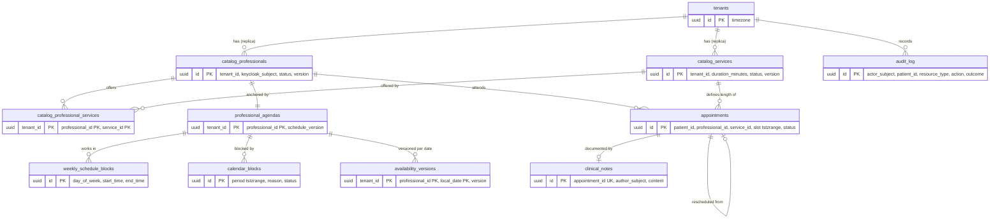
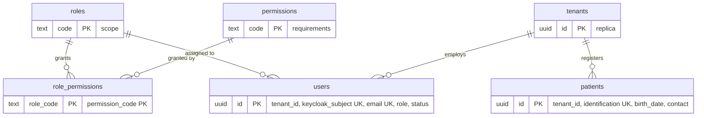
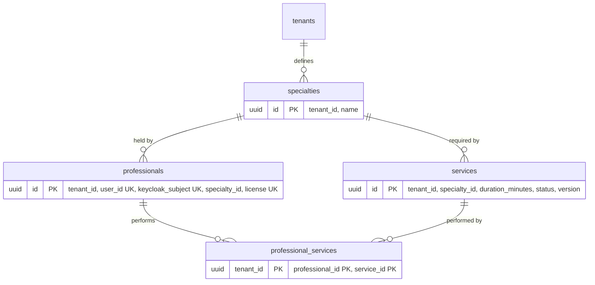

# MediCitas — Data Model

> Scope: relational model of the seven service databases, normalization to 3NF with justification, deliberate denormalizations, invariant → constraint mapping, multi-tenancy and roles.
> Column-level detail lives in the generated [data dictionary](data-dictionary.md). Index rationale is in [index-justification.md](index-justification.md). Seed contents are in [seed-data.md](seed-data.md).

## 1. Physical layout

| Database | Schema | Owner service | Tenant-scoped | Main tables |
|---|---|---|:-:|---|
| `medicitas_tenant` | `tenancy` | tenant-management | ✘ (control plane) | `tenants` |
| `medicitas_onboarding` | `onboarding` | onboarding-orchestrator | ✘ (control plane) | `saga_instances`, `saga_steps` |
| `medicitas_user` | `identity` | user-management | ✔ | `roles`, `permissions`, `role_permissions`, `tenants`*, `users`, `patients` |
| `medicitas_user_orchestrator` | `provisioning` | user-management-orchestrator | ✔ | `saga_instances`, `saga_steps` |
| `medicitas_catalog` | `catalog` | catalog-service-management | ✔ | `tenants`*, `specialties`, `services`, `professionals`, `professional_services` |
| `medicitas_scheduler` | `scheduling` | scheduler-management | ✔ | `tenants`*, `catalog_services`*, `catalog_professionals`*, `catalog_professional_services`*, `professional_agendas`, `weekly_schedule_blocks`, `calendar_blocks`, `availability_versions`, `appointments`, `clinical_notes`, `audit_log`, `scheduling_settings` |
| `medicitas_appointment_orchestrator` | `booking` | appointment-orchestrator | ✔ | `saga_instances`, `saga_steps` |

\* replica, a deliberate denormalization (§4).

Every database also has the shared kernel schema `app` (context accessors, generic triggers) and the reliability tables `outbox_messages`, `inbox_messages` and `idempotency_records` (`database/migrations/common`).

Mapping to the entities the statement requires: **clinic** → `tenants`; **user** → `users`; **role** → `roles` (+ `permissions`, `role_permissions`); **professional** → `professionals`; **service** → `services` (+ `specialties`); **working hours** → `weekly_schedule_blocks`; **agenda block** → `calendar_blocks`; **patient** → `patients`; **appointment** → `appointments`; **clinical note** → `clinical_notes`; **audit record** → `audit_log`.

## 2. Entity-relationship diagrams

### 2.1 Scheduling core (`medicitas_scheduler`)

### 2.2 Identity and patients (`medicitas_user`)

### 2.3 Catalog (`medicitas_catalog`)

### 2.4 Control plane and orchestrators

`tenants` (tenant-management) is the source of truth of the clinic. The three orchestrators share one pattern: `saga_instances 1 ── N saga_steps`, plus the reliability tables. `saga_steps` are keyed by `(saga_id, step_name)`.

### 2.5 Cross-database logical references (no FK possible)

| From | To | Guarantee |
|---|---|---|
| `scheduling.appointments.patient_id` | `identity.patients.id` | Validated by the booking saga (`EnsurePatientCommand`) before `ConfirmAppointment` |
| `catalog.professionals.user_id` | `identity.users.id` | Validated by `GetTenantUserQuery` at registration |
| `*.tenant_id` (application plane) | `tenancy.tenants.id` | Local FK to the replicated `tenants` row, fed by `TenantOnboarded` |
| `scheduling.catalog_*` | `catalog.*` | Event-carried state with aggregate versions |
| `audit_log.actor_subject`, `*_by_subject` | Keycloak user id | Taken from the validated token |

## 3. Normalization (3NF), step by step

**1NF — atomic values, no repeating groups.**
* Working hours are one row per block (`weekly_schedule_blocks`), not an array per professional. RF5 split shifts are simply two rows.
* Patient contact data is split into single-valued columns (`email`, `phone`, `address`) instead of a free-text blob.
* Professional ↔ service associations are rows (`professional_services`), not a list column.
* Intervals use the scalar range types `tstzrange`/`tsrange`. A range is one atomic value with well-defined operators (`&&`), not a repeating group. That is why it can carry exclusion constraints.

**2NF — no partial dependency on a composite key.**
* Composite keys exist only in pure association or versioning tables: `professional_services (tenant_id, professional_id, service_id)`, `availability_versions (tenant_id, professional_id, local_date) → version`, `role_permissions`, `inbox_messages (consumer, message_id)`. Their non-key attributes depend on the **whole** key: `version` belongs to the professional *and* the date.
* `tenant_id` appears in composite unique keys `(tenant_id, id)` only as a **FK target**. It is not a determinant of other attributes in those tables (`id` alone determines the row).

**3NF — no transitive dependency.**
* `appointments` stores `service_id`, **not** the service name or the duration. The end of the slot is a historical fact captured at booking time (I4: later duration changes must not alter existing appointments), and the length is derived from `slot` itself instead of a separate `duration_minutes` column, which would be redundant.
* `appointments` stores `professional_id`, **not** the professional's name or specialty (those depend on the professional).
* `clinical_notes` stores `appointment_id`, **not** `patient_id` or `professional_id` (derivable through the appointment).
* `services.specialty_id` and `professionals.specialty_id` reference `specialties`, so the specialty name is stored once.
* The tenant timezone is stored only in `tenants`. Local dates and times are interpreted through it, not copied into schedules or appointments.
* `users.role` references `roles(code)`. Permissions are derived through `role_permissions`, never stored per user.

## 4. Deliberate denormalizations (documented, as the statement requires)

| Denormalization | Where | Why | How it stays correct |
|---|---|---|---|
| Replicas of `tenants`, `catalog_services`, `catalog_professionals`, `catalog_professional_services` | scheduler (and `tenants` in user/catalog) | RF7 is the most frequent query and must not wait on another service; I1–I4 must be checked in one transaction | Event-carried state with `aggregateVersion` (older events ignored). RF9 cross-checks the authoritative Catalog reply. |
| `professionals.keycloak_subject` (copy of `users.keycloak_subject`) | catalog, and its scheduler replica | Map the token `sub` to the professional for the "own" rules without a remote call | Immutable after creation (a user's subject never changes) |
| `appointments.starts_at`, `appointments.ends_at` (stored generated columns = `lower(slot)`, `upper(slot)`) | scheduler | Range operators are not `LEAKPROOF`, so under RLS they cannot be index conditions. Plain `timestamptz` comparisons can (evidence in `index-justification.md` §1) | Computed by the engine on every write (`GENERATED ALWAYS … STORED`); they cannot be written or diverge |
| `patients.search_last_name`, `patients.search_first_name` (stored generated columns = `lower(last_name)`, `lower(first_name)`) | user | `lower()` is not `LEAKPROOF`: under RLS the expression index on `lower(last_name)` was never used; plain columns with `text_pattern_ops` are (evidence in `index-justification.md` §1c) | `GENERATED ALWAYS … STORED`: maintained by the engine, cannot be written or diverge |
| `availability_versions`, `professional_agendas.schedule_version` | scheduler | Derived counters that make cache keys correct | Bumped in the same transaction as every change |
| `outbox_messages.envelope`, `saga_instances.request/result`, `saga_steps.result`, `idempotency_records.response_body` (JSONB) | all | Serialized messages and process snapshots, not domain data; never queried by attribute | Written once per state change; retention-bounded |
| `outbox_messages.message_type` | all | Operational filtering without parsing JSON | Checked equal by construction (written from the same value) |

## 5. Invariants → database mechanisms

| Invariant | Mechanism | Object |
|---|---|---|
| I1 professional overlap | GiST exclusion `(tenant_id =, professional_id =, slot &&) WHERE status IN ('held','booked')` | `appointments_no_professional_overlap` |
| I2 patient overlap | GiST exclusion on `patient_id` | `appointments_no_patient_overlap` |
| I3 inside hours / outside blocks | `BEFORE INSERT` trigger (weekly block of the local weekday, grid alignment, active calendar blocks) under the agenda anchor lock | `appointments_validate_insert`, `professional_agendas` |
| I4 duration from service | Trigger: `upper(slot) - lower(slot) = service duration`; `slot` is immutable (update guard) | `appointments_duration_matches_service`, `appointments_immutable_facts` |
| I5 tenant isolation | `tenant_id NOT NULL` + composite FKs + RLS `FORCE` on every tenant table + per-actor roles | all application databases |
| I6 append-only audit | No UPDATE/DELETE/TRUNCATE grants + `BEFORE UPDATE/DELETE/TRUNCATE` triggers + RLS | `audit_log_append_only`, `audit_log_no_truncate` |
| I7 immediate release | Status leaves the exclusion predicate in the same transaction; availability version bump | constraint predicate + `bump_availability_versions()` |
| I8 cache never contradicts the DB | Versioned cache key read from the same snapshot as the data | `availability_versions`, `compute_available_slots()` |
| RF13 transitions | `BEFORE UPDATE` state machine | `appointments_valid_transition` |
| RF12 only after start | DB clock check on transition (and on seeded inserts) | `appointments_outcome_after_start` |
| RF15 author and attended | Insert trigger + restrictive RLS `author_subject = app.actor_subject` + immutability | `clinical_notes_*`, `own_notes` |
| RF2 at least one admin | Trigger with tenant-row anchor lock | `users_last_clinic_admin` |
| RF4 specialty match | Triggers on association insert and specialty change | `professional_services_specialty_match`, `professionals_specialty_change_conflict` |

Trigger errors use `ERRCODE check_violation` with a stable `CONSTRAINT` name. The services map these names to API error codes (`appointments_within_working_hours` → `OUTSIDE_WORKING_HOURS`, etc.).

## 6. Multi-tenancy and roles (summary)

* Discriminator: `tenant_id` in every tenant-scoped row, inside composite FKs and unique keys. Queries always filter by it.
* RLS (module 2): `ENABLE` + `FORCE` on every tenant-scoped table. Policy `tenant_id = app.current_tenant_id()`, where the function returns NULL without context, so no rows are visible.
* Roles per database (`database/roles/roles.sql`): `
_owner` (Flyway, `BYPASSRLS`), `
_app` (runtime login, no privileges, `SET ROLE` only), `
_actor` (shared group), one role per matrix profile (`clinic_admin`, `receptionist`, `professional`, `platform_admin`), `
_system` (consumers), `
_worker` (cross-tenant discovery, column-limited), `
_readonly` and `
_bench_norls` (evidence). Prefixes: `tm`, `onb`, `um`, `umo`, `cat`, `sch`, `ao`.
* Restrictive policies add the "own" rules for professionals (schedule, blocks, notes) and limit their appointment updates to outcomes.

## 7. Migrations and seeds

* Cluster bootstrap (`database/bootstrap.sh`): roles → databases → connection privileges → `search_path` → `btree_gist`. Idempotent.
* Flyway (`database/flyway/migrate-all.sh`, image `flyway/flyway:13.11.1`): one run per database as `
_owner`. Locations: `database/migrations/common` (V1_0, V1_1) + `<service>/migrations` (V2…) + `<service>/seed` (V900…, only when `SEED_DEMO_DATA=true`). Placeholders: `rolePrefix`, `schema`, `tenantScoped`.
* Re-running is a no-op (applied versions skipped, checksums validated).
